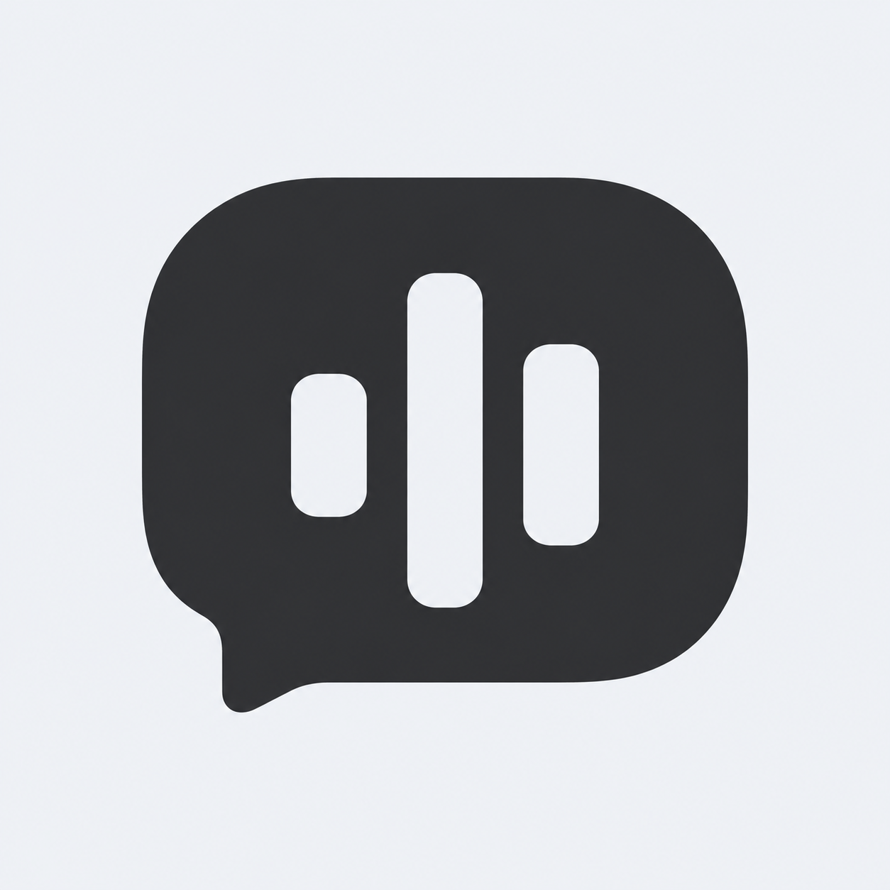
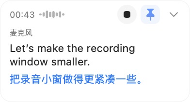
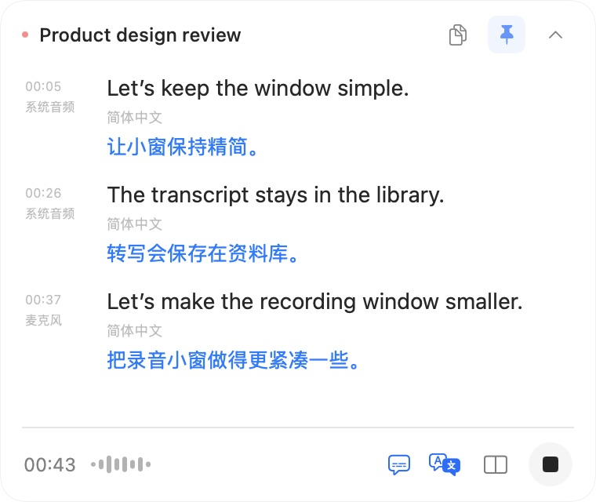
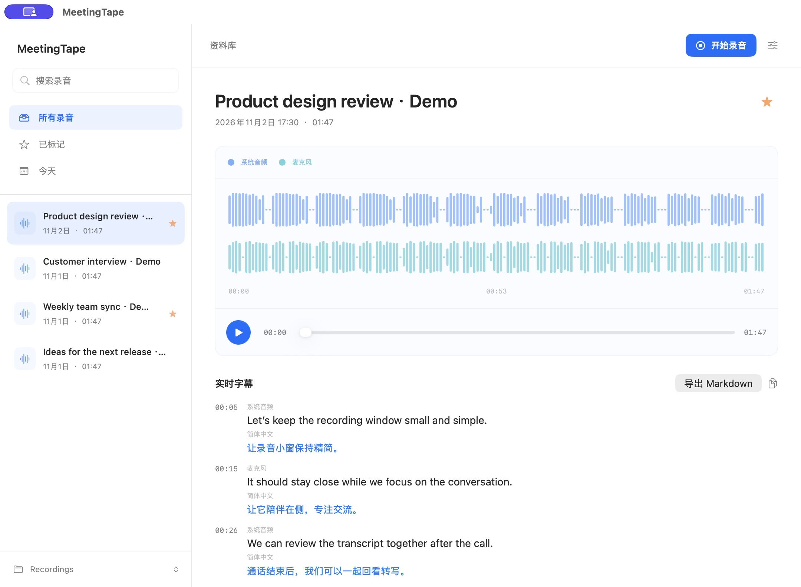
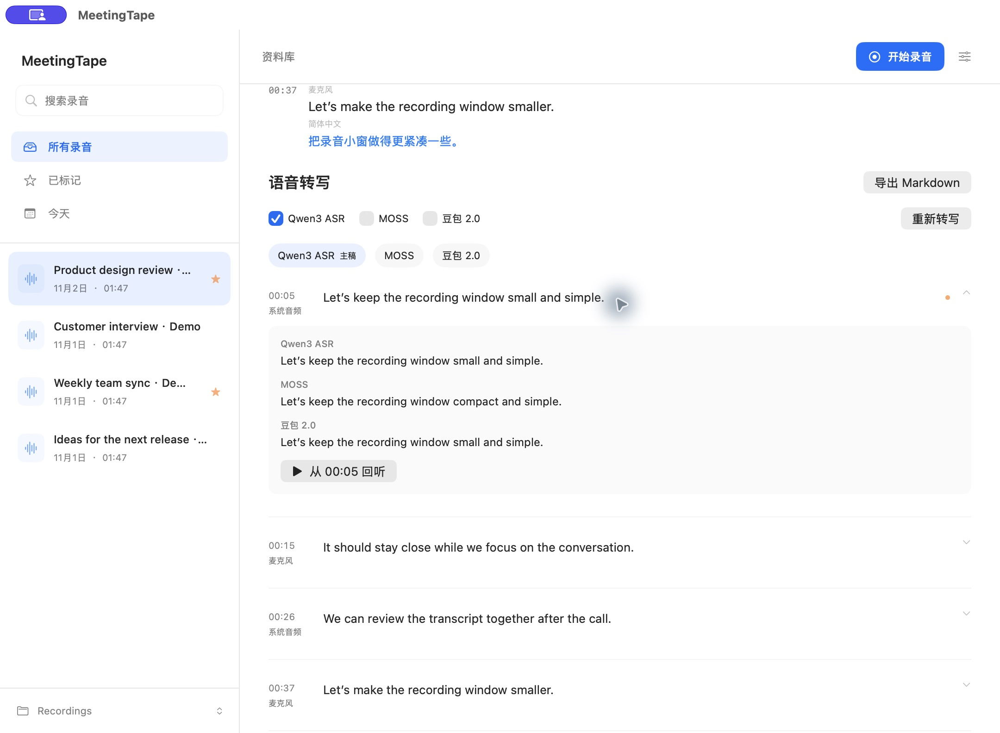

  

<h1 align="center">MeetingTape</h1>

  <strong>Record the meeting. Leave with something you can use.</strong> 
  A native Mac meeting recorder with live captions.

  <a href="https://github.com/patrick-fu/meetingtape/releases/download/v0.4.0/MeetingTape-0.4.0-arm64.dmg"><strong>Download for Apple Silicon</strong></a>
  &nbsp;·&nbsp; v0.4.0

  <a href="https://patrick-fu.github.io/meetingtape/">Website</a> · <a href="README.md">English</a> · <a href="README.zh-CN.md">简体中文</a>

MeetingTape records system and microphone audio, follows the conversation through captions, and keeps every meeting in a searchable library. Return to any point with a click, or export the transcript as a clean Markdown document.

Use it for online calls, interviews, research sessions, and classes—any conversation where listening once is not enough.

## Stay present while the conversation unfolds

  
  &nbsp;&nbsp;
  

Once recording starts, a compact floating window keeps the controls at hand without taking over your screen. Check the timer and waveform, stop when you are done, or pin the window out of the way. Original and translated captions can appear together, and the expanded view keeps more history close by.

## Find the conversation again

Search, rename, favorite, and play every recording from one quiet place. The context stays with the file, so you spend less time hunting and more time using what was said.

## Turn the recording into a document you can share

Read the transcript beside the audio and click any timestamp to hear that moment again. Transcribe the microphone and system audio separately, choose a primary transcript, and compare versions made with different models. Export the versions you want as one Markdown document.

Use SenseVoice for on-device live captions, Qwen or MOSS for saved recordings, or bring your own Doubao key for cloud transcription. Apple’s on-device translation keeps translated captions close at hand.

## Start in a few minutes

1. Download and open MeetingTape.
2. Start recording from your library or the menu bar.
3. Name the meeting, revisit it in your library, and export the transcript when needed.

Requires an Apple Silicon Mac running macOS 14.2 or later.

  <a href="https://github.com/patrick-fu/meetingtape/releases/download/v0.4.0/MeetingTape-0.4.0-arm64.dmg"><strong>Get MeetingTape</strong></a>

---

  <a href="docs/distribution.md">User guide</a> ·
  <a href="docs/transcription.md">Transcription setup</a> ·
  <a href="https://github.com/patrick-fu/meetingtape/releases/tag/v0.4.0">Release notes</a> ·
  <a href="CONTRIBUTING.md">Contributing</a> ·
  <a href="LICENSE">MIT License</a>

