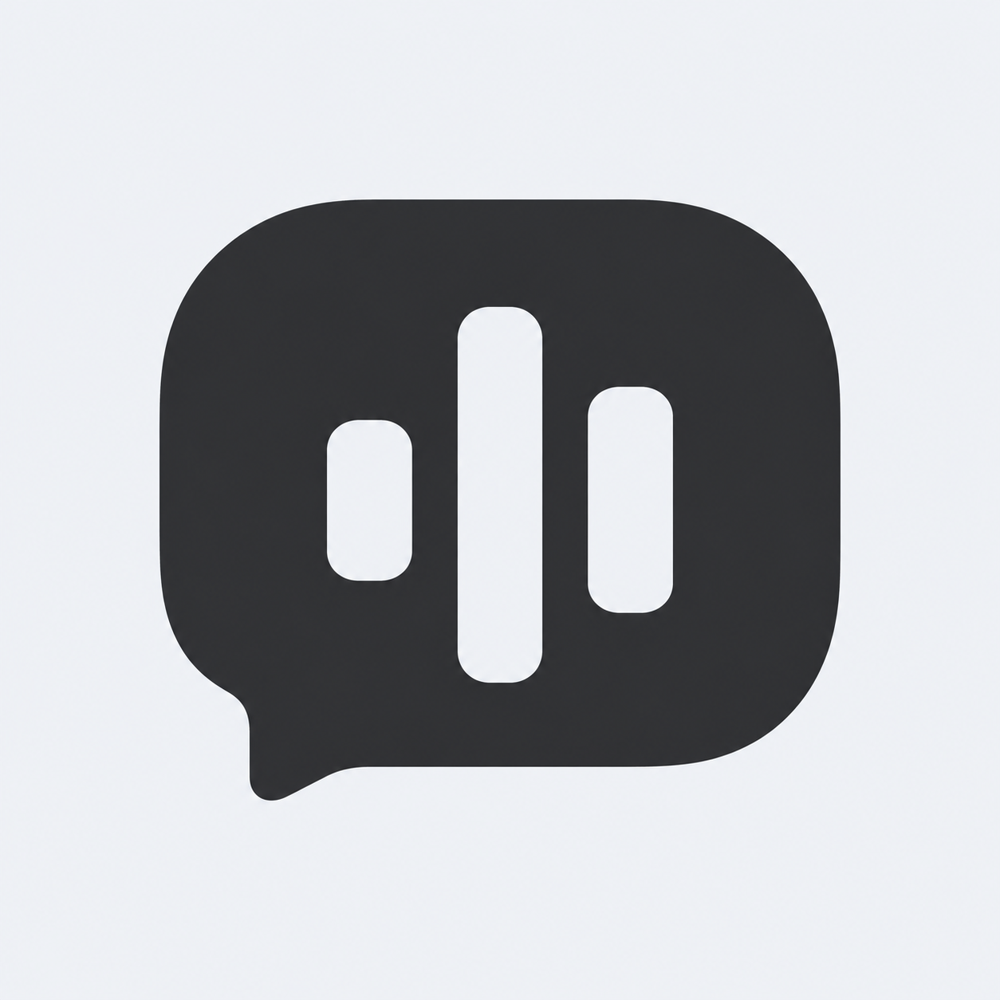
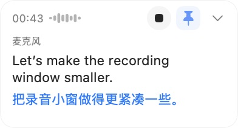
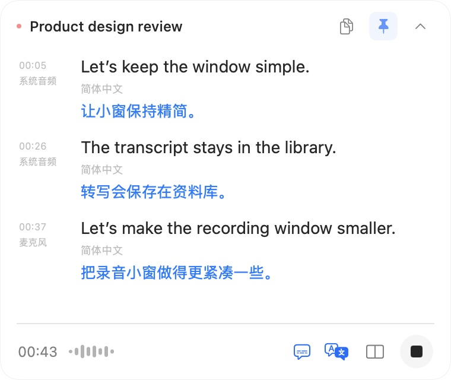
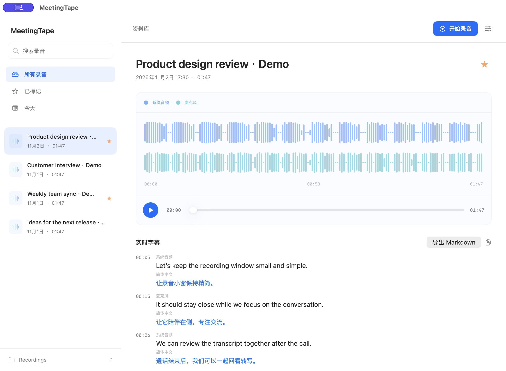
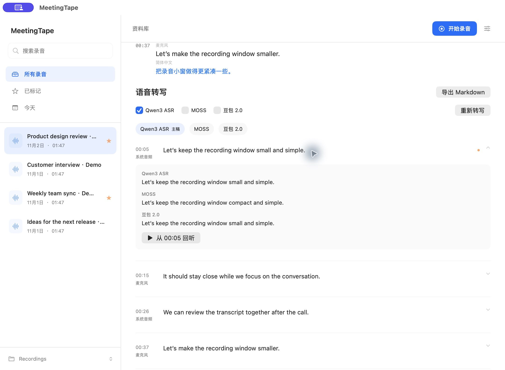

  

<h1 align="center">MeetingTape</h1>

  <strong>录下会议，也留下真正可用的内容。</strong> 
  一款原生 Mac 会议录音与实时字幕工具。

  <a href="https://github.com/patrick-fu/meetingtape/releases/download/v0.4.0/MeetingTape-0.4.0-arm64.dmg"><strong>下载 Apple Silicon 版</strong></a>
  &nbsp;·&nbsp; v0.4.0

  <a href="https://patrick-fu.github.io/meetingtape/">官网</a> · <a href="README.md">English</a> · <a href="README.zh-CN.md">简体中文</a>

MeetingTape 录制系统声音和麦克风，通过字幕让你跟随对话，并把每场会议收进可搜索的录音库。点击任意时间点即可回到原声，也可以把逐字稿导出成 Markdown 文档。

它适合线上通话、访谈、研究讨论和课堂，也适合任何“只听一次还不够”的对话。

## 对话进行时，不必分心操作

  
  &nbsp;&nbsp;
  

开始录音后，紧凑的悬浮窗会让控制项始终触手可及，又不会占满屏幕。随时查看计时和波形，结束时直接停止，也能将窗口固定到一旁。原文与翻译字幕可以同时显示，展开后还能查看更多字幕记录。

## 随时找回重要对话

在同一个清晰的录音库里搜索、重命名、收藏和播放录音。相关信息始终与录音放在一起，省下翻找文件的时间，把精力留给对话本身。

## 把一场对话变成可分享的文档

逐字稿与音频并排显示，点击任意时间点即可回到对应片段。麦克风与系统声音可以分别转写，指定以哪一版为主，并比较不同模型生成的版本。最后按需选择版本，导出为一份 Markdown 文档。

你可以使用 SenseVoice 显示本地实时字幕，用 Qwen 或 MOSS 转写录音，也可以填写自己的豆包密钥使用云端转写；Apple 的设备端翻译让字幕就在手边。

## 几分钟内开始使用

1. 下载并打开 MeetingTape。
2. 从录音库或菜单栏开始录音。
3. 为会议命名，在录音库中随时回看，需要时导出逐字稿。

需要一台运行 macOS 14.2 或更高版本的 Apple Silicon Mac。

  <a href="https://github.com/patrick-fu/meetingtape/releases/download/v0.4.0/MeetingTape-0.4.0-arm64.dmg"><strong>获取 MeetingTape</strong></a>

---

  <a href="docs/distribution.md">使用指南</a> ·
  <a href="docs/transcription.md">转写设置</a> ·
  <a href="https://github.com/patrick-fu/meetingtape/releases/tag/v0.4.0">版本说明</a> ·
  <a href="CONTRIBUTING.md">贡献指南</a> ·
  <a href="LICENSE">MIT 许可证</a>

