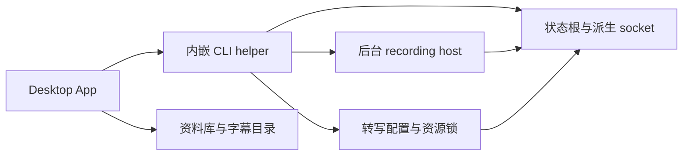

# 开发与验收实例的隔离条件

基线 MeetingTape `f7c010e81d60b9cc9f5adfbe71b3808929120c8e`，2026-11-04。关联[核验开发与验收实例的隔离条件](https://github.com/patrick-fu/meetingtape/issues/70)。以下为静态源码核验；方案和并存行为在[开发与验收环境隔离](https://github.com/patrick-fu/meetingtape/issues/64)讨论与验证。

## 当前资源与消费链路

| 资源 | 生产者与消费者 | 当前隔离条件 |
| --- | --- | --- |
| App / CLI 身份 | 构建脚本消费两份 Info.plist；App 内嵌 CLI helper | debug/release 使用同一套标识：App `com.paaatrickfu.meetingtape.desktop`、CLI `com.paaatrickfu.meetingtape`；产物可存在于不同目录 |
| 签名与系统授权 | Developer ID 签名；Desktop 发起麦克风申请，helper/host 执行采集 | 保持签名与身份契约；权限归属须按实际启动链验证，不能由 Bundle ID 单独推断 |
| 资料库与实时归档 | `LibraryFiles`、`LiveCaptionStore` | 都消费 `MEETINGTAPE_LIBRARY_DIR`；默认 MeetingTape 应用支持目录，字幕位于其 LiveCaptions 子目录 |
| 转写配置、任务与本地资源 | `TranscriptionStore`、Desktop、CLI、worker | 消费 `MEETINGTAPE_TRANSCRIPTION_DIR`；默认 MeetingTape/transcription；相关推理与录音优先锁也位于该根 |
| 录音 host 状态与 IPC | `HostPaths`、`HostClient`、host | `MEETINGTAPE_STATE_DIR` 先标准化并解析符号链接，其路径散列派生 socket；临时根来自 NSTemporaryDirectory |
| 录音活跃判断 | `TranscriptionStore.recordingActive()` | 也消费 STATE_DIR 并检查 session.lock；须与实际录音 host 使用同一状态根 |
| 窗口与录音偏好 | `UserDefaults.standard` / `@AppStorage` | 同 App 身份默认共享偏好；录音输出目录也由偏好选择 |
| 云端凭据 | helper/worker 调用 `TranscriptionCredentials` | service/account 为固定值；改变数据目录本身不分离钥匙串条目 |
| 更新 | `AppUpdater`、Sparkle、Desktop Info.plist | debug/release 当前共用正式 feed；Plist 提供默认值，运行时另有设置与手动检查 |

来源：[build-desktop.sh](https://github.com/patrick-fu/meetingtape/blob/f7c010e81d60b9cc9f5adfbe71b3808929120c8e/scripts/build-desktop.sh#L14)、[Desktop-Info.plist](https://github.com/patrick-fu/meetingtape/blob/f7c010e81d60b9cc9f5adfbe71b3808929120c8e/Resources/Desktop-Info.plist#L4)、[Info.plist](https://github.com/patrick-fu/meetingtape/blob/f7c010e81d60b9cc9f5adfbe71b3808929120c8e/Resources/Info.plist#L5)、[Library.swift](https://github.com/patrick-fu/meetingtape/blob/f7c010e81d60b9cc9f5adfbe71b3808929120c8e/Sources/MeetingTapeDesktop/Library.swift#L47)、[LiveCaptionModels.swift](https://github.com/patrick-fu/meetingtape/blob/f7c010e81d60b9cc9f5adfbe71b3808929120c8e/Sources/MeetingTapeTranscription/LiveCaptionModels.swift#L72)、[Storage.swift](https://github.com/patrick-fu/meetingtape/blob/f7c010e81d60b9cc9f5adfbe71b3808929120c8e/Sources/MeetingTapeTranscription/Storage.swift#L22)、[HostTransport.swift](https://github.com/patrick-fu/meetingtape/blob/f7c010e81d60b9cc9f5adfbe71b3808929120c8e/Sources/MeetingTapeCLI/HostTransport.swift#L55)、[Execution.swift](https://github.com/patrick-fu/meetingtape/blob/f7c010e81d60b9cc9f5adfbe71b3808929120c8e/Sources/MeetingTapeTranscription/Execution.swift#L18)、[Storage.swift](https://github.com/patrick-fu/meetingtape/blob/f7c010e81d60b9cc9f5adfbe71b3808929120c8e/Sources/MeetingTapeTranscription/Storage.swift#L129)、[Credentials.swift](https://github.com/patrick-fu/meetingtape/blob/f7c010e81d60b9cc9f5adfbe71b3808929120c8e/Sources/MeetingTapeTranscription/Credentials.swift#L14)、[AppUpdater.swift](https://github.com/patrick-fu/meetingtape/blob/f7c010e81d60b9cc9f5adfbe71b3808929120c8e/Sources/MeetingTapeDesktop/AppUpdater.swift#L28)。

## 启动链与已有保护

`RecordingClient` 与 `HostClient` 通过 Process 启动子进程，未单独注入开发路径；当前继承启动环境。若以后仅在 Desktop 内按 Bundle ID 计算新目录，需要同时确定子进程获得该选择的方式。

host 的 session lock 默认使用非阻塞 flock，争锁时返回“已有录音”；Desktop 停止时传预期 session ID，host 核验匹配。共享状态意味着不同入口可观察同一录音，但本次没有复现死锁。独立 STATE_DIR 只覆盖 host 路由及其锁；转写根的 recording-intent / inference 锁及录音活跃判断也要同步核对。

来源：[RecordingClient.swift](https://github.com/patrick-fu/meetingtape/blob/f7c010e81d60b9cc9f5adfbe71b3808929120c8e/Sources/MeetingTapeDesktop/RecordingClient.swift#L29)、[HostClient.swift](https://github.com/patrick-fu/meetingtape/blob/f7c010e81d60b9cc9f5adfbe71b3808929120c8e/Sources/MeetingTapeCLI/HostClient.swift#L33)、[HostTransport.swift](https://github.com/patrick-fu/meetingtape/blob/f7c010e81d60b9cc9f5adfbe71b3808929120c8e/Sources/MeetingTapeCLI/HostTransport.swift#L81)、[AppModel.swift](https://github.com/patrick-fu/meetingtape/blob/f7c010e81d60b9cc9f5adfbe71b3808929120c8e/Sources/MeetingTapeDesktop/AppModel.swift#L210)、[RecordingHost.swift](https://github.com/patrick-fu/meetingtape/blob/f7c010e81d60b9cc9f5adfbe71b3808929120c8e/Sources/MeetingTapeCLI/RecordingHost.swift#L72)。

## 凭据与更新的边界

- 钥匙串条目优先；只有 `errSecItemNotFound` 才读取 DOUBAO 环境变量。独立 TRANSCRIPTION_DIR 或设置环境变量不足以覆盖已有钥匙串条目。来源：[Credentials.swift](https://github.com/patrick-fu/meetingtape/blob/f7c010e81d60b9cc9f5adfbe71b3808929120c8e/Sources/MeetingTapeTranscription/Credentials.swift#L32)。
- Sparkle 是否发现/安装更新取决于机器版本、feed、校验及运行时状态；相同营销版本不能单独证明更新。禁用 Plist 默认值也不等于禁用手动入口或所有运行时偏好。来源：[Desktop-Info.plist](https://github.com/patrick-fu/meetingtape/blob/f7c010e81d60b9cc9f5adfbe71b3808929120c8e/Resources/Desktop-Info.plist#L9)、[AppUpdater.swift](https://github.com/patrick-fu/meetingtape/blob/f7c010e81d60b9cc9f5adfbe71b3808929120c8e/Sources/MeetingTapeDesktop/AppUpdater.swift#L37)、[Sparkle 版本说明](https://sparkle-project.org/documentation/publishing/#internal-build-numbers)、[默认值与用户偏好](https://sparkle-project.org/documentation/customization/)。
- 历史 [签名 ADR](https://github.com/patrick-fu/meetingtape/blob/f7c010e81d60b9cc9f5adfbe71b3808929120c8e/docs/adr/0001-signing-and-distribution.md)规划过 CLI/GUI 共用标识；当前两份 Plist 已有独立 Desktop 标识，后续设计应以现状和已发布身份为依据。

## 可供讨论的最小组合

一个候选组合是：开发包使用可辨别的名称/身份；资料库、状态、转写根与输出目录一致分流；helper/host/worker 获得同一环境选择；明确独立凭据条目及更新策略。Developer ID 沿现有要求。

待讨论：一个开发包加正式包是否足够、是否允许并行实际录制、模型文件能否只读复用、测试包怎样取得凭据，以及手动更新入口如何呈现。目录、身份与权限的每一层都需要消费者验证；此报告未验证候选组合的运行态效果。

Cicada 的[开发身份](https://github.com/wquguru/cicada/blob/38771f1a5ae691c848ea429f4a870defd92d9d26/Sources/LiveSubs/DevBuild.swift#L3)与[构建分流](https://github.com/wquguru/cicada/blob/38771f1a5ae691c848ea429f4a870defd92d9d26/scripts/build.sh#L27)提供参考；其机制需与本项目的 helper/host 和资源优先链路一起评估。

## 验证范围

已静态读取构建、目录、IPC、凭据、更新与 ADR；主 agent 结合不同模型的独立复核裁决过强断言，保留可追溯源码事实。实际并存起录/停止、重启、权限归属、更新与凭据操作仍待隔离包验收。
