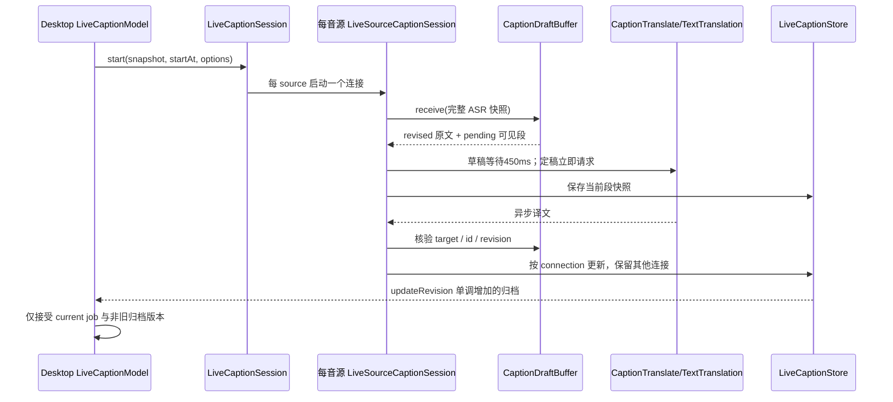

# 实时字幕修订、翻译调度与保存事实核验

核验日期：2026-11-04。对应 [核验实时字幕修订与翻译调度现状](https://github.com/patrick-fu/meetingtape/issues/66)，功能背景 [实时字幕翻译更新策略](https://github.com/patrick-fu/meetingtape/issues/58)。MeetingTape 基线 `f7c010e81d60b9cc9f5adfbe71b3808929120c8e`；参考 Cicada 基线 `38771f1a5ae691c848ea429f4a870defd92d9d26`。只读生产代码；本文未实现新调度策略。

## 结论及适用边界

当前已有版本校验、连接隔离、草稿防抖、旧窗口结果拒收、双音源归档合并和切换覆盖记录。新增空间主要是**跨句/跨音源的请求预算、草稿合并策略、定稿优先级和调度可观测性**，无需重新发明 revision/source/connection 防护。450ms 是当前代码事实，不是本报告建议的产品参数。

没有观察到可由本次离线结果证明的生产数据串写缺陷。探测确证“取消后底层请求仍可能短暂重叠”“多句没有共享并发限制”；请求额度、延迟目标及具体调度策略仍待产品决策；中断或配置变化不自动补历史、目标变化只影响新内容是既有规则，本次继续保留。本报告不把请求并发直接等同于服务端限流或实际费用增加。

## 实际调用链与状态流



1. Desktop `observe` 保存快照，按 elapsed 记录开关覆盖；录音结束时调用 `finish`，允许尾句和翻译继续收尾。新录音替换窗口时，已 finishing 的前录音不取消。`start` 对同一录音等待旧 job 和覆盖写入结束，重新计算 `begin=max(offset, now)` 后才建 service。见 [LiveCaptionModel.swift L94–112](https://github.com/patrick-fu/meetingtape/blob/f7c010e81d60b9cc9f5adfbe71b3808929120c8e/Sources/MeetingTapeDesktop/LiveCaptionModel.swift#L94-L112)、[L170–218](https://github.com/patrick-fu/meetingtape/blob/f7c010e81d60b9cc9f5adfbe71b3808929120c8e/Sources/MeetingTapeDesktop/LiveCaptionModel.swift#L170-L218)。
2. `LiveCaptionSession` 为 recognitionMode 的每个 source 建独立 actor、connection UUID、ASR WebSocket、草稿缓冲和翻译任务表。separate 对应 system 与 microphone，merged 只有一个混合音源；读取音频时分别选左/右声道，merged 各乘 0.5 后相加。见 [LiveCaptionSession.swift L47–87、92–119](https://github.com/patrick-fu/meetingtape/blob/f7c010e81d60b9cc9f5adfbe71b3808929120c8e/Sources/MeetingTapeTranscription/LiveCaptionSession.swift#L47-L119)、[TranscriptSource.swift L30–34](https://github.com/patrick-fu/meetingtape/blob/f7c010e81d60b9cc9f5adfbe71b3808929120c8e/Sources/MeetingTapeTranscription/TranscriptSource.swift#L30-L34)、[LiveAudioReader.swift L125–127](https://github.com/patrick-fu/meetingtape/blob/f7c010e81d60b9cc9f5adfbe71b3808929120c8e/Sources/MeetingTapeTranscription/LiveAudioReader.swift#L125-L127)。
3. 请求配置 `result_type=full`、`show_utterances=true`；codec 从每帧的 utterances 或 fallback text 生成段，`definite` 优先决定段 final，否则使用帧 final。Buffer **按当前数组位置**重写 id 为 `connectionID:index`，不使用 codec 的时间 id；收到的段表整体替换当前连接草稿，不是 append 增量。正文、start、end、final 任一变化都会增加 revision；相同快照保留译文、不发新请求。见 [LiveCaptionSession.swift L175–178](https://github.com/patrick-fu/meetingtape/blob/f7c010e81d60b9cc9f5adfbe71b3808929120c8e/Sources/MeetingTapeTranscription/LiveCaptionSession.swift#L175-L178)、[DoubaoLiveCodec.swift L42–69](https://github.com/patrick-fu/meetingtape/blob/f7c010e81d60b9cc9f5adfbe71b3808929120c8e/Sources/MeetingTapeTranscription/DoubaoLiveCodec.swift#L42-L69)、[CaptionDraftBuffer.swift L14–31](https://github.com/patrick-fu/meetingtape/blob/f7c010e81d60b9cc9f5adfbe71b3808929120c8e/Sources/MeetingTapeTranscription/CaptionDraftBuffer.swift#L14-L31)。因此“段位置保持”的假设属于 full 结果契约；本次未连云验证服务是否会撤回、重排已有句。
4. revised 段先变为 `pending`，旧译文不沿用；scheduler 取消该 id 的旧 task。草稿 sleep 450ms，final 无 sleep，然后调用 translator；前后各检查一次 cancellation。成功进入 apply，异常且 task 未取消则写 `failed`。Buffer 仅接受目标语言相等、id/revision 在可见表和原文表同时匹配的结果。见 [LiveCaptionSession.swift L263–309](https://github.com/patrick-fu/meetingtape/blob/f7c010e81d60b9cc9f5adfbe71b3808929120c8e/Sources/MeetingTapeTranscription/LiveCaptionSession.swift#L263-L309)、[CaptionDraftBuffer.swift L34–44](https://github.com/patrick-fu/meetingtape/blob/f7c010e81d60b9cc9f5adfbe71b3808929120c8e/Sources/MeetingTapeTranscription/CaptionDraftBuffer.swift#L34-L44)。
5. `TextTranslation` 每段用 NLLanguageRecognizer 判断语言；与目标同语言时直接 `sameLanguage`，不请求翻译服务。否则按显式 provider 走 Apple 本地或豆包，**没有自动跨 provider 回退**。本地要求 macOS 26、已安装语言包、session ready；云端每次建 URLSession，request 15s、resource 20s，并检查 HTTP/业务码、译文数/大小。见 [TextTranslation.swift L10–85](https://github.com/patrick-fu/meetingtape/blob/f7c010e81d60b9cc9f5adfbe71b3808929120c8e/Sources/MeetingTapeTranscription/TextTranslation.swift#L10-L85)。语言判断正确率和框架实际取消响应不在离线探测范围。

## 可达时序、重叠和积压边界

| 情形 | 当前可达行为 | 保障或限制 |
| --- | --- | --- |
| 草稿持续在450ms内变化 | 旧 sleep 被取消，尚未调用 translator；每次修订重新等待 | 是尾沿防抖，不是固定频率刷新；持续修订可以一直 pending |
| 同一句请求已发出，再修订/定稿 | 取消旧 task并创建新 task，定稿立即发 | 适配器若不及时响应取消，新旧底层工作可同时存在；后置 cancellation check阻止旧结果落库 |
| 多个定稿句同时到达 | 每个 revised id创建独立 task | 无共享 semaphore、并发上限、启动间距、队列容量或优先队列；定稿跳过防抖不等于全局定稿优先 |
| 只有时间戳变化或仅 final 变化 | revision增加并重新翻译相同正文 | 无按文本/目标/provider缓存去重；full 历史批量修订可触发多句并发 |
| 同一帧不含旧 id | 旧 id task被取消，buffer整体替换 | id是数组索引；不能只靠“id还存在”判定结果有效，还需revision和任务取消 |
| 双音源同时说话 | 两套独立调度同时发请求 | source通过connection隔离；provider没有跨音源预算；不能把actor理解为“一次仅一个网络请求” |
| 一路识别失败 | 另一路继续；retryFailed仅重开末连接状态failed的source | 新连接从重连时刻开始，不回补前面缺口；翻译失败本身不触发这条ASR重连逻辑 |
| 翻译失败 | 该revision写failed，保留已取得字幕 | 不自动重试；相同ASR快照不再请求，下一次修订才可能再发 |
| 正常结束 | 发送音频final，等待ASR尾包（12s deadline），然后等待当前translations任务表 | 12s不是翻译总deadline；本地翻译和自定义适配器没有本层总超时；等待时长依适配器 |
| 取消/识别错误收尾 | 取消翻译任务、清掉originals并保存部分归档 | cancel分支另有cancelled护栏；错误结束后discardOriginals使迟到apply无法匹配 |

以上依据 [LiveCaptionSession.swift L65–86、185–249、263–309](https://github.com/patrick-fu/meetingtape/blob/f7c010e81d60b9cc9f5adfbe71b3808929120c8e/Sources/MeetingTapeTranscription/LiveCaptionSession.swift#L185-L309)。任务表只保存每id最新task，成功完成后不主动remove，直至id消失或session结束；被替换的旧task不再由表持有，不表示其底层服务已停止。单帧/单源段数上限20,000，store合并后仍有20,000段及16MiB上限；这些是文本归档保护，不是请求并发预算。[LiveCaptionModels.swift L80–100](https://github.com/patrick-fu/meetingtape/blob/f7c010e81d60b9cc9f5adfbe71b3808929120c8e/Sources/MeetingTapeTranscription/LiveCaptionModels.swift#L80-L100)。

## 开关、目标语言与迟到结果

- 开关原文/翻译、改目标语言、改provider均调用reconfigure，记录覆盖并对**整个当前实时会话**重启；即使只改目标语言，也会重新建ASR连接。旧服务options是let，不原地修改。旧任务先取消，等待旧job归档，再从当前now开启；不重新翻译历史段、不补录连接间空档。[LiveCaptionModel.swift L114–151、189–218](https://github.com/patrick-fu/meetingtape/blob/f7c010e81d60b9cc9f5adfbe71b3808929120c8e/Sources/MeetingTapeDesktop/LiveCaptionModel.swift#L114-L218)。
- 两个功能全关不创建ASR；只开翻译仍要云端ASR。只开翻译时可见/保存原文字段为空，但内存originals保留待翻译原文；同语言时把原文放入translation.text，目标字幕只保存一份。[CaptionDraftBuffer.swift L23–44](https://github.com/patrick-fu/meetingtape/blob/f7c010e81d60b9cc9f5adfbe71b3808929120c8e/Sources/MeetingTapeTranscription/CaptionDraftBuffer.swift#L23-L44)。
- Desktop通过job id拒收旧窗口回调，再用归档updateRevision拒收更旧版本；归档仍保留旧连接历史，切目标后可能同时出现不同目标语言的历史段。紧凑窗口按最大end（再按start）选latest，不依数组最后项；reconfigure不会立即清segments，所以新连接首更新前可继续显示旧段，而新开关已经生效。这是源码可达短暂显示状态，未运行GUI实测。[LiveCaptionModel.swift L57–79、148–151、221–235](https://github.com/patrick-fu/meetingtape/blob/f7c010e81d60b9cc9f5adfbe71b3808929120c8e/Sources/MeetingTapeDesktop/LiveCaptionModel.swift#L221-L235)。
- jobs数量小于4才可新建；达到上限时停止启动并提示稍后重连。上限限制会话收尾，不限制每会话的翻译并发。[LiveCaptionModel.swift L196–218](https://github.com/patrick-fu/meetingtape/blob/f7c010e81d60b9cc9f5adfbe71b3808929120c8e/Sources/MeetingTapeDesktop/LiveCaptionModel.swift#L196-L218)。

## 归档、复制和导出的消费结果

`LiveCaptionStore` 是actor，updateConnection每次重新读当前归档，仅移除同connectionID段再追加本连接段，按start/id排序，保留其他音源和旧连接。atomic写入、大小限制和读取验证保护已有归档；updateRevision每次递增。coverage按音源与feature保存enabled/disabled/unknown、目标语言，控制记录链串行，晚到时间不会倒退已有区间。[LiveCaptionModels.swift L93–147](https://github.com/patrick-fu/meetingtape/blob/f7c010e81d60b9cc9f5adfbe71b3808929120c8e/Sources/MeetingTapeTranscription/LiveCaptionModels.swift#L93-L147)。

complete由连接complete、段final及partial决定；failed翻译会使partial。**pending翻译不直接使partial，也不参与complete判定**；正常生产结束先等待当前翻译任务并非仅靠store断言。本次人工构造“completed连接+final段+pending译文”可被store标为complete，仅证明store层契约较弱，不证明正常结束会产生此状态。[LiveCaptionSession.swift L226–240](https://github.com/patrick-fu/meetingtape/blob/f7c010e81d60b9cc9f5adfbe71b3808929120c8e/Sources/MeetingTapeTranscription/LiveCaptionSession.swift#L226-L240)。

消费端并不完全等价：

| 消费端 | 读取内容 |
| --- | --- |
| 录音窗口“复制已定稿字幕” | 过滤segment.final后拼plainText；final是ASR定稿，并未额外等待译文。pending/failed且没有原文时可能贡献空字符串 |
| 资料库实时归档 | 根据sessionID+archiveRevision重新load；归档修订计数在job finished增加，不是每条流式译文都触发资料库重载 |
| 归档“复制实时字幕” | 所有段plainText，包括未定稿；不带时间、来源、pending/failed提示 |
| Markdown导出（桌面/CLI） | 重新读磁盘归档，逐段保留时间、source、未定稿标签、原文及译文状态、coverage/连接区间和可得统计 |

见 [LiveCaptionModel.swift L78–80、231–235](https://github.com/patrick-fu/meetingtape/blob/f7c010e81d60b9cc9f5adfbe71b3808929120c8e/Sources/MeetingTapeDesktop/LiveCaptionModel.swift#L78-L80)、[LiveCaptionArchiveView.swift L16–35](https://github.com/patrick-fu/meetingtape/blob/f7c010e81d60b9cc9f5adfbe71b3808929120c8e/Sources/MeetingTapeDesktop/LiveCaptionArchiveView.swift#L16-L35)、[LibraryView.swift L188–190](https://github.com/patrick-fu/meetingtape/blob/f7c010e81d60b9cc9f5adfbe71b3808929120c8e/Sources/MeetingTapeDesktop/LibraryView.swift#L188-L190)、[LiveCaptionModels.swift L14–19](https://github.com/patrick-fu/meetingtape/blob/f7c010e81d60b9cc9f5adfbe71b3808929120c8e/Sources/MeetingTapeTranscription/LiveCaptionModels.swift#L14-L19)、[MarkdownExport.swift L36–56、92–146](https://github.com/patrick-fu/meetingtape/blob/f7c010e81d60b9cc9f5adfbe71b3808929120c8e/Sources/MeetingTapeTranscription/MarkdownExport.swift#L92-L146)。导出含elapsedSeconds和成功保留结果的usage，不能还原被取消/覆盖请求的总费用或队列耗时。

## Cicada参考：可借鉴与不可直接照搬

- 草稿由0.25秒timer每四tick触发，`volatileInFlight`限制草稿只有一个在途，并跳过上次相同文本；定稿另起task。草稿epoch拒收跨草稿生命周期的结果，定稿比较当前句正文防止合句前结果覆盖。[ListenEngine.swift L483–539、598–612](https://github.com/wquguru/cicada/blob/38771f1a5ae691c848ea429f4a870defd92d9d26/Sources/LiveSubs/ListenEngine.swift#L483-L612)。这与MeetingTape当前每id防抖不同，可用来设计对照实验；不是所有翻译只有一个在途。
- 草稿跳过Ling，整句/语音可走Ling，再Google、Apple回退；Ling共享启动门限0.6秒、按priority及seq出队，允许请求重叠。**启动间距不等于并发限制，Ling gate也不覆盖Google/Apple所有路径。** [Translator.swift L68–104](https://github.com/wquguru/cicada/blob/38771f1a5ae691c848ea429f4a870defd92d9d26/Sources/LiveSubs/Translator.swift#L68-L104)、[Ling.swift L379–413](https://github.com/wquguru/cicada/blob/38771f1a5ae691c848ea429f4a870defd92d9d26/Sources/LiveSubs/Ling.swift#L379-L413)。MeetingTape目前显式provider选择应继续作为约束，不能把调度研究变成自动更换服务。
- 关闭后恢复时Cicada重译屏幕末三句，而MeetingTape只重建从now开始的连接；MeetingTape继续沿用不补历史、目标变化只影响新内容的规则，不引入Cicada的历史重译行为。[ListenEngine.swift L622–632](https://github.com/wquguru/cicada/blob/38771f1a5ae691c848ea429f4a870defd92d9d26/Sources/LiveSubs/ListenEngine.swift#L622-L632)。

## 实际检查及可复现证据

可复现材料随研究分支保存于 [evidence/translation/](evidence/translation/README.md)：手写输入[Main.swift](evidence/translation/Main.swift)、源码提取器[make_probe.py](evidence/translation/make_probe.py)、[run.sh](evidence/translation/run.sh)及本轮原始日志[result.txt](evidence/translation/result.txt)。脚本将可执行文件、提取副本和合成归档生成到系统临时目录，结束后清理，不把这些可再生产物纳入研究分支。`make_probe.py`从当前源码原样提取schedule；SubtitleModels/CaptionDraftBuffer直接参与编译，LiveCaptionModels完整复制。只用最小独立RecognitionMode/TranscriptionFailure类型替代Core模块依赖，TranscriptSource移除模块import。调度probe的ingest按生产receive的取消/调度步骤搭建，apply使用真实buffer但只收集结果，**没有执行生产WebSocket、Desktop或持久化回调时序**。

运行方式（仓库根目录）：

```sh
bash docs/research/feature-planning/evidence/translation/run.sh
```

13项检查全部通过：相同快照不重发；仅时间戳变化修订；仅final变化修订；拒收旧revision；拒收错误目标；仅翻译同语言只保存一次；80ms内草稿被定稿替换只调用一次；不响应取消的假适配器下同句峰值并发2；旧结果被后置check拦截；12个不同定稿句峰值并发12；store可接受pending+complete人工状态；第二音源写入保留第一音源；discardOriginals后拒收迟到结果。适配器仅等待本地650ms并返回合成文字，不访问网络。

已读既有检查：[SubtitleTests.swift L5–67](https://github.com/patrick-fu/meetingtape/blob/f7c010e81d60b9cc9f5adfbe71b3808929120c8e/Tests/MeetingTapeTranscriptionTests/SubtitleTests.swift#L5-L67)覆盖revision、目标、仅译文、coverage和Markdown；[LiveCaptionLifecycleTests.swift L61–225](https://github.com/patrick-fu/meetingtape/blob/f7c010e81d60b9cc9f5adfbe71b3808929120c8e/Tests/MeetingTapeDesktopTests/LiveCaptionLifecycleTests.swift#L61-L225)覆盖长源修订、单路重试、跨录音迟到重试、前录音收尾及重连归档屏障。**本轮未运行这些项目测试**，不把已读当作通过。

Apple一手资料用于解释API边界：[Task.checkCancellation](https://developer.apple.com/documentation/swift/task/checkcancellation())、[TranslationSession installedSource初始化](https://developer.apple.com/documentation/translation/translationsession/init(installedsource:target:))。官方资料确认checkCancellation在已取消时抛CancellationError；installedSource初始化从macOS 26起可用，语言未安装时翻译会报错。本轮通过官方Markdown直链读取成功；分支只保留一手链接，不保存完整官方文档副本。关于实际取消行为的结论以本地假适配器实验及源码检查为准，不推断云端请求一定停止。

## 后续调度改动的最小验收清单（建议，未执行）

| 场景 | 至少观察的消费者结果 |
| --- | --- |
| 高频草稿→定稿，旧请求晚返回 | 可见段、保存JSON和Markdown都只保留匹配revision的译文；定稿不被草稿覆盖 |
| 双音源批量定稿+一侧慢/失败 | 两路句子不互相覆盖；记录实际请求启动、在途峰值、排队和最终等待时间；单侧故障不饿死另一侧 |
| 关翻译/关原文/全关后重开 | 当前job退出、覆盖区间、原文字段和译文字段符合选择；不误补历史；新连接前短暂旧显示须做交互验收 |
| 在请求中改目标/provider | 旧结果不进入新连接；导出保留历史目标；继续遵守目标变化仅影响新内容、不自动回译历史的既有规则 |
| 正常结束/取消/断网/保存失败 | 最终归档可读、部分状态真实；明确pending处理；旧job归档不覆盖新窗口；停止等待有可测边界 |
| timer/capacity/priority任一新机制 | 与现有450ms基线比较同一合成输入的请求数、final等待、草稿新鲜度、内存/在途峰值；不预设参数值 |
| 复制及导出 | 分别验证“已定稿复制”、归档复制、Markdown的实际产物，不能仅看内存buffer或UI显示 |

未覆盖：真实云ASR full帧修订/重排契约，真实Apple语言识别/包安装/取消时延，豆包限流与实际用量，App GUI及系统采集，长会话负载及内存基准，整套构建和既有测试执行。生产修复或产品交互选择不属于本报告交付。
