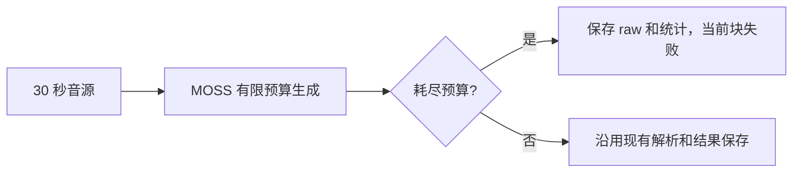

# MOSS 静音音源的重复退化

在 v0.2.3 的分音源录后转写中，用户发现系统音频稿持续重复同一英文短句。读取原始 JSON 确认：新任务已完成的 61 个系统音频块返回完全相同的正文，每块均耗尽 8192 个生成 token，首块正文为 8610 字符。首块对应的系统声道约 −115 dBFS RMS，接近静音；同一路 Qwen 正文为空。这些证据支持静音上的模型幻觉，不是界面重复、正常讲话或字幕翻译。未据此证明所有异常均由静音触发。

先前的 Qwen 修复只保护 Qwen。MOSS 仍固定申请 8192 tokens，且没有耗尽检查；退化结果又包含无效/零长度时间段，既有解析 fallback 会把正文作为整块文本展示。默认 MOSS 提示要求转写，不要求英文翻译。

## 本次改动

MOSS 每个块的预算改为 `max(512, ceil(duration * 64))`。30 秒为 1920 tokens，比 Qwen 预留更多时间戳/说话人标记空间，亦接近上游 MLX runtime 默认 2048 的量级。EOS 不计入运行时的 `generation_tokens`；达到预算的结果被视为未正常结束，保存原始响应/统计，返回明确错误并非零退出。既有 Swift worker 因而保留此前完成进度，不提交当前异常块。

本次不通过音量阈值删除安静语音、不对 MOSS 标记 token 施加未经对照验证的重复惩罚、不改历史稿件、不取消用户正在运行的任务。**该改动阻止耗尽循环被发布，不代表解决所有模型幻觉，也不会把静音自动判为成功空稿。** MOSS 会在第一个此类异常块停止该音源，另一音源按既有 worker 逻辑继续处理。

时间戳解析仍有独立边界：现有 parser 可能丢弃不完整尾段，且结构化空白可以合法地解析为空。独立审查发现直接禁用 fallback 会改变兼容性，故本次不修改解析器；未耗尽的短幻觉/格式错误不在本 PR 验收范围。

## 实际验证（2026-11-04）

- 7 个 Python 回归测试在系统 Python 与实际模型运行时通过。修改前 runner 的两个 MOSS 耗尽测试失败；正常说话人分段与空输出测试通过。既有 Qwen 和失败 JSON/非零退出检查保留。
- 在同一首块音频实际运行修复后的 MOSS：生成到 1920 tokens 后返回错误，退出码1，原始响应和统计保留，未返回可发布 `text`。这证明故障被明确阻止，而不是证明模型已经给出了正确空稿。
- 真实模型的合成中文语音对照：成功保留一个带时间戳的语音段，内容覆盖研究计划、负责人和期限。未作多语言或密集多说话人质量评估。
- `./scripts/build-apm.sh` 通过，包括480帧consumer；`swift test` 的65个测试通过；`git diff --check` 通过。
- 私有录音、会议正文、截图和运行输出仅本机保存，不随本报告或 PR 上传。安装的签名 App 未修改。跨模型复核未完成：此前 Cursor CLI 身份不可用，仅独立代码审查，不宣称多模型验证。

上游接口与格式参考：[MLX runtime](https://github.com/vanch007/mlx-MOSS-Transcribe-Diarize)、[OpenMOSS 输出格式](https://github.com/OpenMOSS/MOSS-Transcribe-Diarize)。
