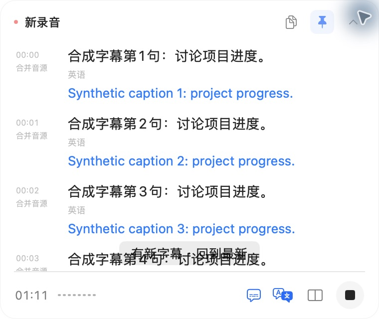
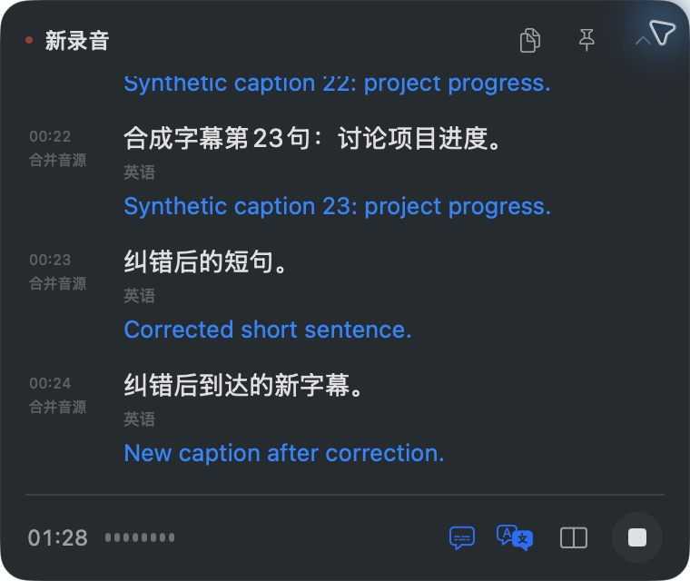

# 字幕窗交互验收

2026-11-06，Apple Silicon、macOS 26.6.2，对应 [#75](https://github.com/patrick-fu/meetingtape/issues/75)。

**制品。** `scripts/build-desktop.sh debug` 完整构建通过，App 与内嵌组件通过 Developer ID 嵌套签名检查。`swift test --jobs 4`：XCTest 3 项通过；Swift Testing 报告 65 项，其中 2 项云端 opt-in 跳过。无 CI。

**消费端。** 临时签名验收器加载与生产文件逐字节相同的 `RecordingPanel.swift`（SHA-256 `f023600c5bead94fbab15ecc1c9bb1e545b1fef3670d3e4e6cf58a7c38632c58`），使用真实 NSPanel、SwiftUI、AppModel 与 RecordingClient；字幕及 CLI 响应使用合成夹具。偏好与数据目录独立，未采集音频或调用模型。

| 检查 | 观测 |
| --- | --- |
| 回看后追加字幕 | AX 滚动到历史顶部，追加字幕后滚动条仍为 0，显示“有新字幕 · 回到最新” |
| 恢复跟随 | 点击提示后定位到最新内容，后续字幕继续显示 |
| 同句纠错 | 最后一段由长文本修订为短句，再追加新段，最新原文和译文均可见，未进入回看状态 |
| 尺寸与外观 | 小窗 196×106、展开 380×320 逻辑点；深浅色均检查 |
| 置顶与停止 | 取消置顶后状态为“未置顶”；停止关闭面板，RecordingClient 调用带当前 sessionID 的 stop |
| 已保存位置恢复 | 注入本显示器右侧 220、顶部 150 点的夹具偏移，重启后实际 frame 为 (1888, 1009, 196, 106)，展开为 (1704, 795, 380, 320)，右上锚点一致 |
| 缺失显示器与越界坐标 | 保存不存在的显示器 ID 和越界偏移后重启，实际回到主屏可见区域 (10, 58, 196, 106) |

**回归。** 仅监测滚轮的旧实现中，AX 回看后新增字幕会跳到底部；修补后同一操作保留顶部位置。新增的裁剪区域观察同时覆盖滚动条和辅助功能引起的位置变化。

**范围。** 人工拖动后的位置写入、真实多屏插拔、跨 Space/全屏及 macOS 14.2 实机仍待检查。CUA 拖动命中原生 DragView，但事件中的系统鼠标按下状态为 0，窗口未移动，因此本轮位置恢复使用显式偏好夹具验证。录音与识别质量沿原有验收记录。

| 浅色：阅读历史并收到新字幕 | 深色：纠错后继续跟随 |
| --- | --- |
|  |  |
