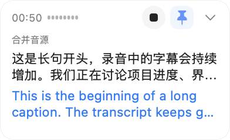
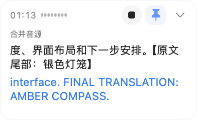

# 小窗长字幕跟随验收

2026 年 11 月 11 日，Apple Silicon、macOS 26.6.2。对应[录音小窗长字幕自动滚动跟随](https://github.com/patrick-fu/meetingtape/issues/87)，基线 `a5330ec`，本地执行。

## 可见结果

紧凑窗原先用两行截断全文，长句更新后仍停在开头。现在按 176pt 正文宽度和 11pt 字体取最新尾部；原文、译文独立跟随。完整文字仍保存在模型、归档与展开窗中，辅助功能标签也保留完整句子。

以下为相同长句在基线和首次修复中的原生对照；最终版保留相同排版算法，另补有界缓存和完整辅助功能文本。

| 基线 | 最新内容跟随 |
| --- | --- |
|  |  |

## 原生消费端

签名验收器编译生产 `RecordingPanel.swift`、AppModel 和 LiveCaptionModel；会话、字幕及停止 helper 使用隔离合成夹具。最终面板文件与生产源码 SHA-256 均为 `10bb08e30c7a3440e367a9fbba7fe8b215a68ed6c3974eea31541513abbbfc69`。

| 检查 | 实际观测 |
| --- | --- |
| 超长中文与英文 | 同一份 294 字中文及 964 字符英文，基线停在开头；修复后两路尾标均可见 |
| 持续追加与纠错 | 连续三次追加显示新结尾，同长度改字显示纠正后的结尾；长句改短句后正常显示短句 |
| 延后译文 | 合成服务先给原文和空译文，再保持原文不变、补入长译文；译文自动显示其结尾 |
| 单路与双路 | 仅原文、仅译文均显示最新结尾；恢复双语后两路均正常 |
| 原有交互 | 196pt 紧凑窗、380×320 展开窗；pin 跨展开/收起保留，阅读历史时新消息不拉走位置，点击提示恢复跟随 |
| 停止 | 首轮实际点击后 helper 收到指定 session 的 stop，快照 completed、面板隐藏；最终增量未改停止路径 |
| 完整辅助文本 | 最终原生 AX 同时包含原文/译文的完整开头及结尾，可见正文保持尾部 |
| 绘制回执与归档 | 最终合成归档保留完整文本；共取得原文 11 条、译文 11 条原生 AppKit 绘制回执 |

## 构建与独立审查

- 最终完整 App 的 Developer ID 签名构建及严格嵌套校验通过。
- 最终既有本地检查：XCTest 3 项通过；Swift Testing 报告 88 项通过，显式启用的模型、云端和设备 smoke 按日志跳过。未新增重复单测。
- Qwen 4 high 实现；GPT‑6.1 Sol Max、Grok 4.7、GLM 5.3 独立审查，并复核最终缓存与辅助功能增量。
- 审查发现的重复排版已处理：有效上限附近的单次布局约 7–21ms，不能据此声称实测帧率故障。两槽同步缓存避免计时刷新时重复布局；从生产类提取的探针确认两路隔离、输入变化失效、相同输入复用及缓存有界。
- 无障碍文本缺失已由最终原生 AX 复验关闭。最终无待处理的 P0/P1/P2；固定宽度与字号的联动约束保留在代码中，未来调整尺寸时需同步排版常量。

| 实际制品 | SHA-256 |
| --- | --- |
| 完整 App executable | `2c4730214e97eeb6d843f49002086a1fc279ece8202d1eb74c83541c3a6fd1ea` |
| 原生验收器 executable | `53ff20d48de27b4022d4f427caf4a6d6119c1adbd981860621825b0acc1e9632` |

本轮验证字幕展示与交互；实际 VoiceOver 播音、macOS 14.2 实机、Spaces 及物理录音音质未在本轮重测。未运行 CI，未发布。
