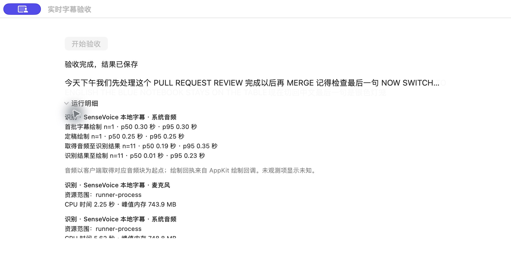

# Local live captions acceptance

Recorded on 9 November 2026. Checks ran locally on Apple Silicon; no CI run.

## Actual consumer

A signed native verifier used the production caption model, text views, draw acknowledgements, and statistics view. It sent a 13.835-second synthetic Chinese/English recording through the production RecoveryStore reader and installed SenseVoice runtime at recording speed. The system channel contained speech; the microphone channel was silent.

- Both source connections completed. The Chinese/English utterances and final phrase “银色灯笼” appeared. The silent channel produced no caption.
- All 11 recognition observations received native draw acknowledgements.
- The saved archive reported complete, with no partial intervals.
- The App's full statistics JSON matched the public CLI projection. The shared statistics Markdown matched the block in the CLI export byte for byte.



This verifies synthetic audio through the real local model and native rendering. It does not establish physical capture quality. A draw acknowledgement records an AppKit draw callback in a visible window, rather than physical display presentation.

## Runtime and failure paths

- Install into an empty owned directory, validate model and license hashes, and complete a real ready/finished handshake. Model downloads were exercised; pip used cached wheels.
- Damage the active installation and repair it into a new generation. Preserve the old generation until the replacement validates.
- Interrupt before and after publishing the installation pointer. The active target remains intact in both cases.
- Delay a controlled runner while committed audio stays queued. The original implementation withheld available captions; asynchronous pipe writes and actor scheduling allow captions to arrive before the backlog drains.
- Check a 20-second PCM bound, original sample ranges, empty-draft withdrawal, and the final 181-sample tail. Four Python regression checks pass.
- Verify local model selection and the independent recognition switch in the native settings UI.

The client audio anchor is the read of the PCM block containing the segment end. Resource values cover the runner process. Unknown measurements remain unknown in the App, JSON, and Markdown.

## Public commands

```sh
meetingtape transcribe live status
meetingtape transcribe live install
meetingtape transcribe stats <session-id>
meetingtape transcribe export <session-id> --primary live --output captions.md
```

Physical AEC, near-end speech and double talk, device changes, sleep/wake, long-run drift, Spaces/fullscreen behavior, and macOS 14.2 machine coverage remain on the hardware acceptance tickets.
