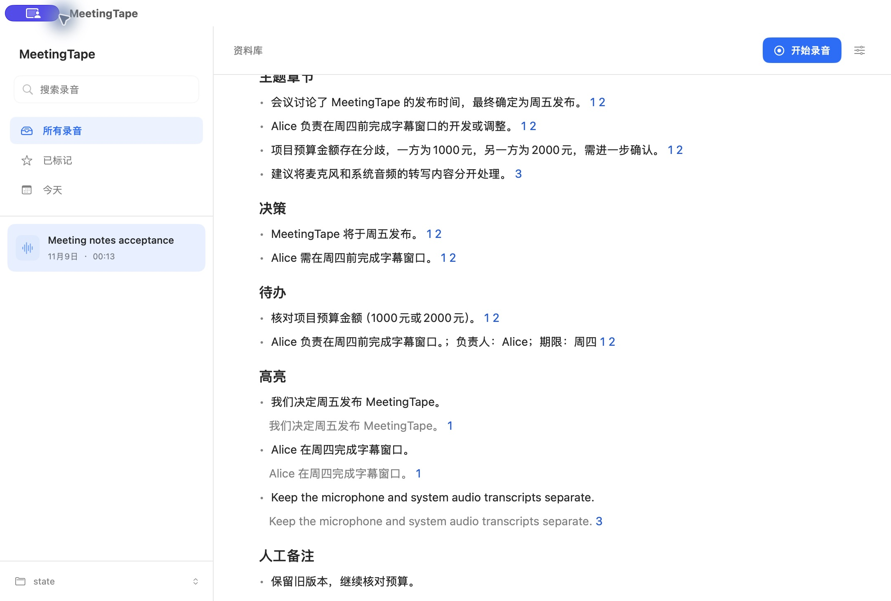
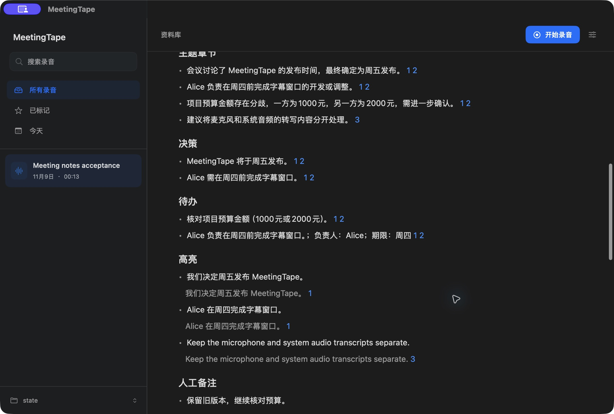

# Meeting notes and confirmed terms acceptance

Recorded on 9 November 2026. All inputs were synthetic. Checks ran locally on Apple Silicon; no CI run.

## Native App

- Read notes generated by GPT-4.1 from three synthetic source excerpts. The conflicting budgets, 1000 and 2000, remained marked for verification with both sources.
- Edit notes into version 2, then return to version 1. Both persisted. Existing versions keep their saved Markdown.
- Expand the frozen citation at 00:08 and locate the audio at exactly eight seconds. Playback remained paused.
- Cancel an actual local model request. The previous two versions remained, and the persisted run and UI reported interruption.
- Confirm a candidate term, add two aliases, preserve its spelling, ignore another candidate, and search by alias.
- Test a local text endpoint from settings. Check notes, terms, and model settings in light and dark mode.
- Export the selected edited version through the App and its embedded CLI. The two files matched byte for byte, including frozen citations and confirmed terms.

## Automatic generation and exit

The `AutomaticMinutesLifecycle` consumer test uses the production App model, a delayed caption producer, and a loopback HTTP fixture.

| Scenario | Observed result |
| --- | --- |
| Live captions without automatic post-recording ASR | Notes wait for the saved final utterance. |
| Post-recording task finishes before the live tail | Notes include the final live utterance. |
| Immediate exit releases the caption producer | The queued notes run becomes interrupted; no model request is sent. |
| Caption persistence prevents exit | After restoring the directory, the same App instance generates notes for a new session. |

Restoring the old exit order issued a request with an unfinished utterance. Removing exit recovery prevented generation for the next session. The corrected four-case run sent exactly three requests, for the two completed sessions and the session after exit recovery.

Run the fixture with `python3 Tests/Fixtures/minutes-model.py <temporary-provider-directory>`. It writes `endpoint.txt`. In a second terminal, set `MEETINGTAPE_LIBRARY_DIR` and `MEETINGTAPE_TRANSCRIPTION_DIR` to separate temporary directories, set `MEETINGTAPE_MINUTES_LIFECYCLE_ENDPOINT` to that endpoint, and run `swift test --filter AutomaticMinutesLifecycle`. Stop the fixture after the check.

## Model coverage

GPT-4.1 passed the multi-transcript conflict case. A local Qwen2.5 3B model answered HTTP requests but failed that semantic case twice. Local connection support does not establish that model's suitability for meeting notes.

The real Doubao backfill check remains pending Keychain access for the signed engineering App. Its unfinished job was preserved before exit. Physical capture and acoustic checks remain tracked separately.
