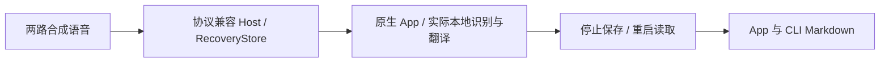

# 原生字幕端到端验收

2026 年 11 月 10 日，Apple Silicon，本地执行；源码基于 `e29e0af`。使用 Developer ID 签名的完整 App 与内嵌 CLI、实际安装的 SenseVoice 和 Apple 本地翻译。

## 业务路径

在独立测试资料库中通过设置页一键安装本地字幕模型，观察下载、校验及就绪状态，再选择本地识别。协议兼容的合成 Host 按录音速度提交两路不同语音；App 使用实际状态查询、字幕读取、显示、停止和入库路径。Host 使用生产 RecoveryStore，采集输入由合成 PCM 替代。

基线运行 230.5 秒，复现两项问题：切换字幕开关时正常取消可能被保存成连接失败；短中文被识别为另一繁简标签后进入不支持的本地翻译语言对。

修复后再运行 135.5 秒，实际操作双语、仅译文、全关闭、仅原文、恢复双语，展开/收起、pin、修改标题、停止保存和重启。

| 消费结果 | 观测 |
| --- | --- |
| 连接终态 | 6 条主动取消、2 条正常完成、0 条失败；最后两路均读到 135.5 秒 |
| 尾句 | 最后两路的句子均定稿，结束时间到达 135.499985 秒 |
| 关闭期间 | 原文与翻译各保留两路关闭区间；归档继续标记部分字幕，保留 3 条取消时未定稿的旧草稿 |
| 中文短句 | 新任务“今天下”成功；真实 NL/ICU 回归另覆盖“今天下午”和双向繁简转换 |
| 保存与重启 | 资料库显示 02:15，标题“本地双语修复验收”与字幕保留，无取消引发的连接失败提示 |
| 导出 | App 与公共 CLI 的 21,256 字节 Markdown 完全一致，包含关闭区间与运行明细 |
| 文件 | AAC、48 kHz、双声道，解码 6,504,000 帧与提交帧数相等；首、中、末采样窗分别匹配原来的左右音源 |

观察到 116 条识别结果，其中 89 条有原生绘制回执；关闭原文期间及被新结果替代的草稿不要求逐条绘制。实际 App 重启后的运行明细显示识别、翻译时延及 runner CPU/内存数据。

## 回归与制品

- 中文参数化回归在修复前 3 例均因语言对不支持失败，修复后通过。受控慢 runner 的既有回归增加取消终态检查并通过。
- 全量本地套件 88 项通过；需显式启用的云端、设备及模型 smoke 另计。签名 App 构建与严格校验通过。
- 既有 CLI 恢复验收器执行两轮、每轮 17 步，通过合成恢复路径；第二轮使用已有输出文件检查保全。验收器整体仍为 `PARTIAL`。
- Sol 与 Gemini 独立审查；针对 ICU 词语转换的争议另用实际 Foundation 输出核验。

| 实际受测制品 | SHA-256 |
| --- | --- |
| App executable | `eb84cb0eff59f84fc2c3c5d213bf80f35908ac1fe0d05686f684584709967134` |
| 内嵌 CLI | `dfdb5d57f03cd2db27e1eb86882742ca80954553483e19145c2d54d3d30e3801` |
| App/CLI Markdown | `c8d5fdb3bc4fb8b2b263123b5906d7b298626902e508db7bbbae13454c9057b3` |

App 使用隔离的测试 bundle ID、资料库与运行目录；源码和模型路径均为生产实现。验收材料、合成素材及签名制品保存在本机项目验收归档中。

## 待验证与限制

中英混杂或失真的短草稿仍可能被语言检测判成其他语言；本轮保留 8 个草稿翻译失败任务，最终句翻译失败为 0。繁简转换处理中文书写形式，地域词汇和通用语言检测继续沿原实现。

云端重启补齐在正常钥匙串读取处等待用户许可，退出后任务为 interrupted，尚无成功请求证据。真实云端 WebSocket 的握手/高负载取消也未实测。

本轮使用合成音源，物理采集、AEC 音质、近端语音及双讲、设备切换、睡眠、长期漂移、跨 Space/全屏和 macOS 14.2 实机继续在硬件验收票中跟踪。未运行 CI，未合并或发布。
